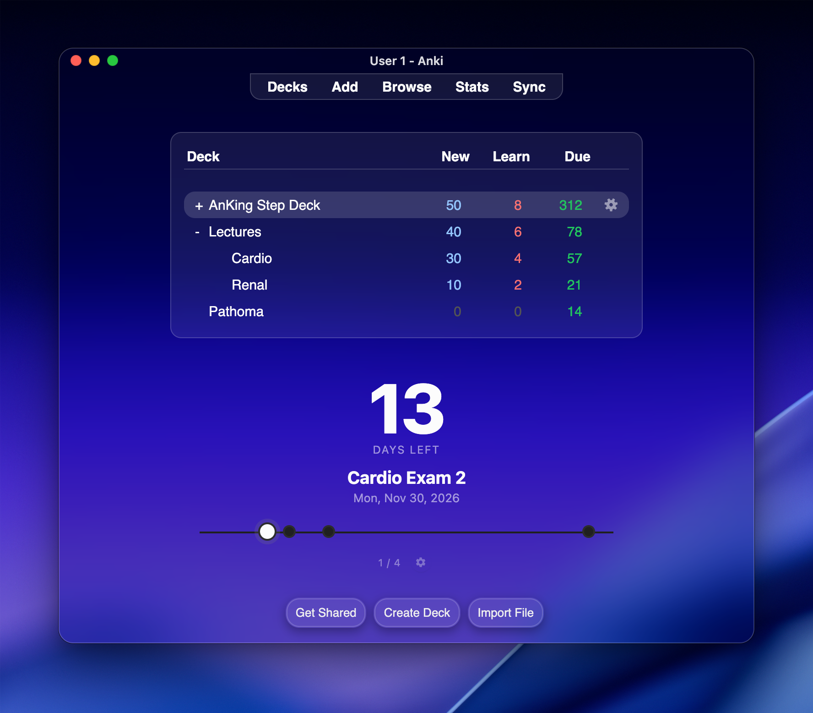
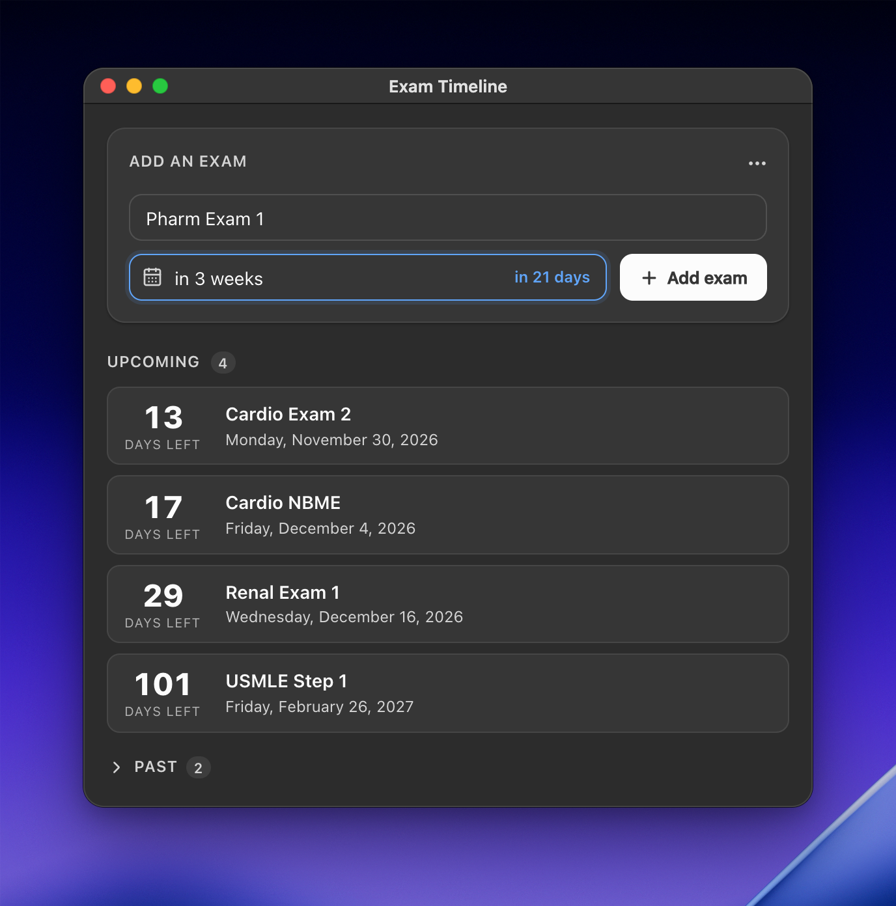

# Exam Timeline

An [Anki](https://apps.ankiweb.net/) add-on that puts a countdown to your next
exam on the deck screen: a large "days left" number above a timeline of all your
upcoming exams, nearest first.



<sub>Shown with [AnkiGlass](https://github.com/AIbrahimv2/AnkiGlass), which gives Anki's main window macOS Liquid Glass.</sub>

## Features

- **Timeline widget** on the deck (home) and deck-overview screens showing
  upcoming exams, nearest first, each with a **large day countdown**. Use the
  **← / →** arrow keys to step through exams.
- **Separate editor window** for adding, editing and removing exams — the
  widget itself stays read-only.
- **Type dates the way you'd say them**: "Nov 20", "11/20", "next friday",
  "in 3 weeks". The calendar opens as you start and shows the date as you type
  it, and the box says how far away it is, so a typo can't slip through. Or pick
  it from the calendar, which marks the days you already have exams on.
- Removing an exam **asks first**, so a stray click can't lose one.
- Exams **persist** between sessions and past exams are hidden from the widget
  automatically.

## Usage

The timeline appears on the deck and deck-overview screens. To manage exams, open
**Tools → Exam Timeline** (or click the **gear** next to the countdown): type a name
and a date, and press **Enter** or click **Add exam**. Hover over an exam to edit
it (pencil) or remove it (**×**). Changes appear on the deck screen immediately.



The calendar opens when you click or tab into the date field and follows what you
type. To go further ahead, click the month's name to pick a month, and the year to
pick a year. **↓** moves into the calendar: there, the arrow keys move a day or a
week, **Page Up / Page Down** a month (with **Shift**, a year), **Enter** picks
and **Esc** goes back a level or closes it.

## Installation

### From AnkiWeb

In Anki, open **Tools → Add-ons → Get Add-ons** and paste the code
`341595498`. It needs Anki 24.04 or newer. See the
[AnkiWeb page](https://ankiweb.net/shared/info/341595498).

### Manual

Download `anki-exam-timeline.ankiaddon` from the
[Releases](https://github.com/AIbrahimv2/AnkiExamTimeline/releases) page and
double-click it, or run `./build.sh` and open the file it writes to `dist/`.

## Development

The add-on lives in `src/`. The editor window is a small React app in `web/`,
built into `src/web/` (the built files are committed, so `src/` works as is).
To test changes live, symlink `src/` into your Anki add-ons folder and restart
Anki:

```bash
ln -s "$(pwd)/src" ~/Library/Application\ Support/Anki2/addons21/anki-exam-timeline
```

- `npm --prefix web run build` rebuilds the editor after changes in `web/`.
- `python3 tools/devserver.py --exams src/meta.json` runs the editor in a
  browser at http://127.0.0.1:5181, against the add-on's real Python commands
  and a copy of your exams (`npm --prefix web run dev` for live reload).
- `./tests/run.sh` runs the tests: date reading (Node), the editor's commands
  (Python) and the editor in Anki's own web view (Anki's Python).
- `./build.sh` builds the editor and writes a distributable `.ankiaddon` to
  `dist/`.
- `python3 tools/screenshots.py` renders `docs/screenshot.png` and
  `docs/editor.png` (used here and on AnkiWeb) from made-up exams, with
  Chromium, Anki's own stylesheets and AnkiGlass's (from `../anki-glass`),
  on macOS Tahoe's dark wallpaper. Rerun it after changing how either looks;
  `--plain` leaves out AnkiGlass, and `--wallpaper` or `--capture-wallpaper`
  (the desktop's own) picks another.

Never use `<input type="date">`, `<select>` or other controls with a native
popup in the editor: in Anki's web view on macOS they crash Anki.

## License

[AGPL-3.0-or-later](LICENSE).
