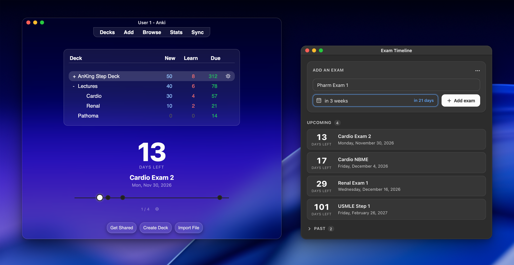

# AnkiWeb listing

What's live at https://ankiweb.net/shared/info/341595498. Edit it at
https://ankiweb.net/shared/upload?id=341595498, and update this file in the
same session.

## Package on AnkiWeb

Version 1.2.0, uploaded 2026-11-17. The release script (`release.py --uploaded`
in the `anki-addon-release` skill) updates this line after each upload.

## Title

📅 Exam Timeline: a countdown to your upcoming exams on the deck screen

## Tags

exam countdown timeline days until exam date days remaining exam day deadline study planner study plan test date target date board exam usmle step1 step 1 step 2 comlex nbme shelf exam mcat nclex bar exam

## Search

Searched on 2026-11-15, before and after the tags above replaced the old
ones, with the `ankiweb_search.py` approach from the `anki-addon-release`
skill. "Results" is how many add-ons match now. AnkiWeb sorts results by
ratings, so an add-on without ratings comes after every rated match; the
words only decide whether it shows up.

- Tags match whole words. "study plan" didn't find the tag "study planner",
  while the title and description match parts of words ("mac" finds
  "macOS"). So the tags spell out the exact words people type.
- Neighbouring tags read as a phrase, so their order matters.
- Left out on purpose: "timer", "schedule", "reminder" and "motivation":
  people searching those want other things (review timers, scheduling,
  notifications).

| Search | Results | Before | After |
| --- | --- | --- | --- |
| exam | 817 | #809 | #664 |
| exam countdown | 12 | #11 | #10 |
| countdown | 64 | #45 | #60 |
| exam date | 24 | absent | #24 |
| exam day | 8 | absent | #3 |
| days until | 10 | absent | #8 |
| days left | 7 | #5 | #4 |
| days remaining | 6 | absent | #2 |
| target date | 9 | absent | #6 |
| test date | 2 | absent | #2 |
| deadline | 29 | #21 | #21 |
| study planner | 9 | #9 | #3 |
| study plan | 25 | absent | #22 |
| board exam | 8 | absent | #3 |
| usmle | 49 | absent | #36 |
| step 1 | 73 | absent | #61 |
| step1 | 38 | absent | #27 |
| step 2 | 54 | not run | #53 |
| comlex | 18 | absent | #11 |
| nbme | 15 | absent | #15 |
| shelf exam | 5 | absent | #4 |
| mcat | 22 | absent | #11 |
| nclex | 3 | absent | #3 |
| bar exam | 2 | absent | #2 |
| calendar | 52 | #46 | #38 |

## Support page

https://github.com/AIbrahimv2/AnkiExamTimeline/issues

## Supported Anki versions

Minimum 24.04, maximum 26.09.4 with no `-`, so newer versions get it too. The
form turns 24.04 into "24.04.0", and the listing shows "24.04-26.09.4+".

Anki says the code is invalid to anyone below the minimum. Until 2026-11-14
both were 26.09.4, the version installed at the time, so only 26.09.4 and
newer could install it. Checked after the change with
`curl -s -o /dev/null --max-filesize 1 -w '%{http_code}' "https://ankiweb.net/shared/download/341595498?v=2.1&p=<point version>"`:
404 for 2.1.66, 23.10 and 23.12.1 (p=66, 231000, 231201), and 303 (a
download) for 24.04 to 26.10 (240400 up).

Why 24.04:

- It's the first release whose Mac, Windows and Linux builds all ship Qt 6.6,
  whose web view is Chromium 112. The editor's stylesheet uses `color-mix()`,
  which needs Chromium 111, so on the Qt 6.5 builds (2.1.66, and 23.12 on
  Mac) most of its colours would be missing. Nothing else in the editor or the
  deck-screen widget needs a newer browser.
- Up to 25.02, Anki runs add-ons on Python 3.9. Exam Timeline works there.
- The deck-screen widget uses `deck_browser_will_render_content` and
  `overview_will_render_content` (their `stats` and `table` sections), which
  24.04 has.

Tested on 2026-11-14 with `tests/run_on_anki.sh <version>`. All the tests
(dates, bridge, and the editor in Anki's web view) pass on 24.04, 24.06.3,
24.11 and 25.02.7 (Python 3.9, Qt 6.6), 25.07.5 and 25.09.4 (Python 3.13, the
launcher's default Qt 6.9), and 26.09.4 (the installed app). The 1.1.0 code,
which is what AnkiWeb serves, passes on 24.04 and 25.07.5. Not tested: the
launcher's optional Qt 6.7 and 6.8 builds, which sit between versions that
pass. Rerun the tests on the minimum before each release.

## Description

Paste as is. AnkiWeb takes Markdown and basic HTML. It follows the layout in
the `anki-addon-release` skill's listing conventions: what it does, the code
line and the screenshot first, the signature last.

```markdown
Puts a countdown to your next exam on Anki's deck screen: a large **days left** number above a timeline of all your upcoming exams, nearest first.

**Code: 341595498.** Paste it in Anki under **Tools → Add-ons → Get Add-ons**. Needs Anki 24.04 or newer.

<p></p>

<p><small>Shown with <a href="https://ankiweb.net/shared/info/1866406123">AnkiGlass</a>, which gives Anki's main window macOS Liquid Glass.</small></p>

**Features**

- A clean timeline widget on the **deck (home)** and **deck overview** screens, showing one exam at a time with a large **days left** number. The nearest exam comes first.
- Press the **← / →** arrow keys to step through your exams.
- Add, edit and remove exams in a separate editor window: **Tools → Exam Timeline**, or click the gear next to the countdown.
- Type a date the way you'd say it ("Nov 20", "11/20", "next friday", "in 3 weeks"), or pick it in a calendar that marks the days you already have exams on.
- Exams are saved between sessions, and past exams disappear on their own.

Source, changelog and issues: [github.com/AIbrahimv2/AnkiExamTimeline](https://github.com/AIbrahimv2/AnkiExamTimeline)

<p><a href="https://abdelrahmanibrahim.com/anki/"></a></p>
```
